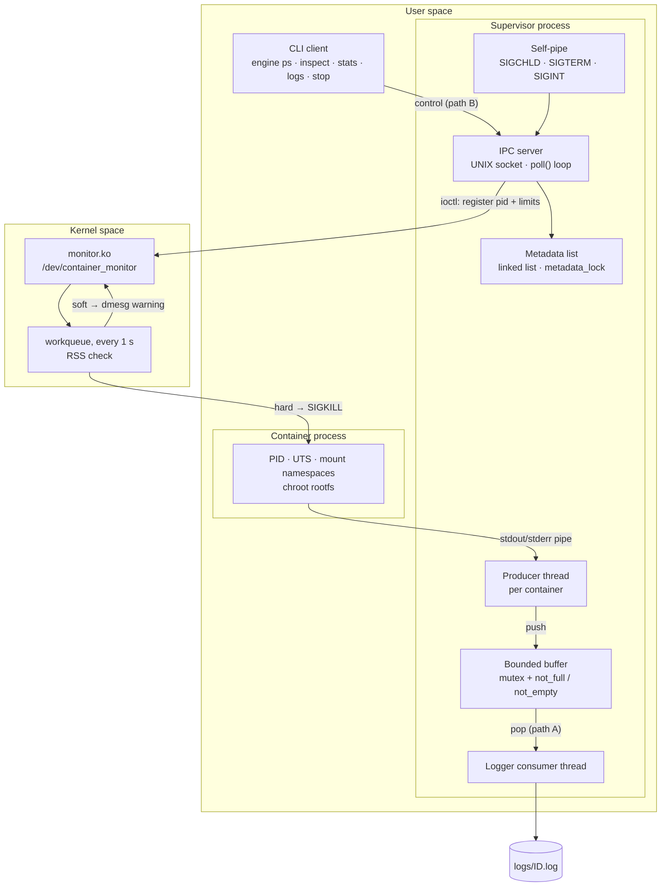
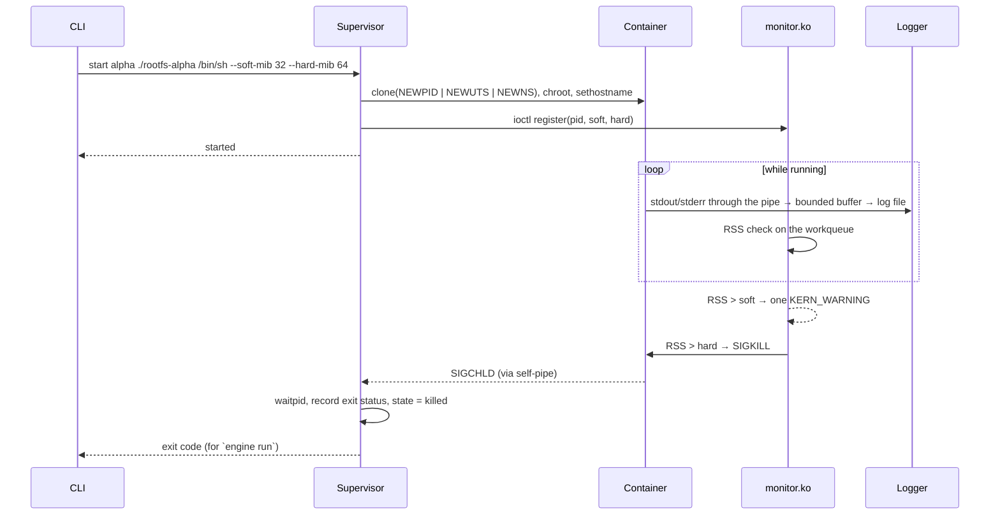
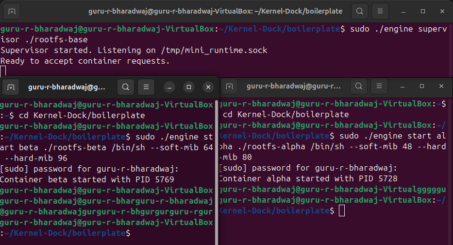
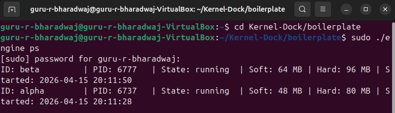
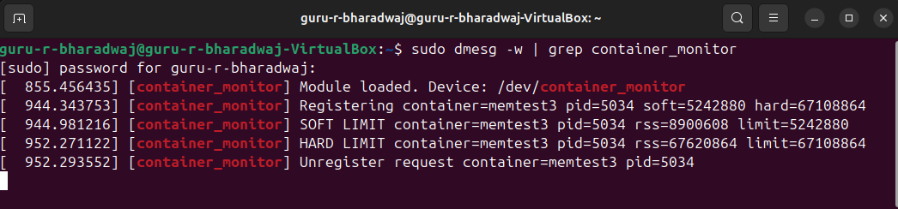
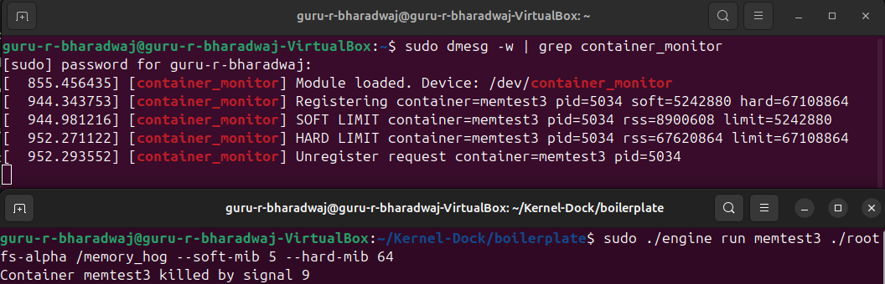

# Kernel-Dock

**A Linux container runtime built from scratch in C — namespaces, a supervisor daemon, a kernel module that enforces memory limits, and a full CLI, without Docker or cgroups.**

[](.github/workflows/submission-smoke.yml)
[](boilerplate/engine.c)
[](boilerplate/monitor.c)
[](boilerplate/environment-check.sh)
[](boilerplate/test_experiments.sh)
[](project-guide.md)

Containers are processes with a different view of the system. Kernel-Dock
builds that view by hand: `clone()` with PID, UTS and mount namespaces plus
`chroot()` for isolation, a long-running supervisor for lifecycle and logging, a
UNIX-socket CLI, and a loadable kernel module that watches each container's RSS
and kills it from kernel space when it crosses a hard limit.

---

## Contents

| Section | |
|---|---|
| [What it does](#what-it-does) | The feature surface, by area |
| [Architecture](#architecture) | Supervisor, CLI, logging pipeline, kernel monitor |
| [How a container runs](#how-a-container-runs) | Start, supervise, warn, kill, reap |
| [Quick start](#quick-start) | Rootfs, build, load, supervise, use |
| [CLI reference](#cli-reference) | Commands and their output |
| [Results](#results) | Scheduling and memory-limit experiments |
| [Project status](#project-status) | What works, and the known limits |
| [Design decisions](#design-decisions) | Safety properties, and why |
| [Repository layout](#repository-layout) | Where things live |
| [Team](#team) | Who built it |

---

## What it does

| Area | Capabilities |
|---|---|
| **Isolation** | `CLONE_NEWPID`, `CLONE_NEWUTS` and `CLONE_NEWNS` via `clone()`, plus `chroot()` into a per-container Alpine rootfs |
| **Memory enforcement** | `monitor.ko` checks RSS every second: a soft limit warns once in `dmesg`, a hard limit sends `SIGKILL` from kernel space |
| **Supervisor** | Long-running parent that owns lifecycle, IPC and logging, reaps zombies and tracks exit status |
| **Logging** | Per-container producer threads read stdout/stderr pipes into a bounded buffer drained by one consumer thread |
| **CLI** | `start`, `run`, `ps`, `inspect`, `stats`, `logs [--follow]`, `stop` over a UNIX socket |
| **Lifecycle** | `STARTING → RUNNING → STOPPING → STOPPED`, with `EXITED` and `KILLED`; SIGTERM escalates to SIGKILL after a grace period |
| **Scheduling** | Per-container `--nice`, used to measure CFS behaviour |
| **Output** | Aligned tables with live RSS and uptime, a 1 s stats dashboard, ANSI colours disabled for non-TTY pipes |

---

## Architecture



---

## How a container runs



---

## Quick start

> Ubuntu 22.04 or 24.04 in a VM with Secure Boot off. WSL and macOS do not work.

```bash
# 0 — toolchain and a preflight check
sudo apt update && sudo apt install -y build-essential linux-headers-$(uname -r)
cd boilerplate && sudo ./environment-check.sh

# 1 — root filesystems: one Alpine base, one writable copy per container
mkdir -p rootfs-base
wget https://dl-cdn.alpinelinux.org/alpine/v3.20/releases/x86_64/alpine-minirootfs-3.20.3-x86_64.tar.gz
sudo tar -xzf alpine-minirootfs-3.20.3-x86_64.tar.gz -C rootfs-base
for c in alpha beta gamma; do sudo cp -a rootfs-base rootfs-$c; done

# 2 — build (make debug: ASan + UBSan · make ci: no module, no sanitizers)
make
for c in alpha beta gamma; do sudo cp memory_hog cpu_hog io_pulse rootfs-$c/; done

# 3 — load the kernel module
sudo insmod monitor.ko && ls -l /dev/container_monitor

# 4 — terminal 1: the supervisor
sudo ./engine supervisor ./rootfs-base

# 5 — terminal 2: containers
sudo ./engine start alpha ./rootfs-alpha /bin/sh       --soft-mib 32 --hard-mib 64
sudo ./engine start gamma ./rootfs-gamma "/cpu_hog 30" --nice -5 --soft-mib 40 --hard-mib 64
sudo ./engine ps
sudo ./test_experiments.sh                    # 10 tests, PASS/FAIL table

# 6 — cleanup: Ctrl-C the supervisor (SIGTERM to all, logs drained), then
sudo rmmod monitor && ./cleanup_verification.sh
```

---

## CLI reference

```
engine supervisor <base-rootfs>
engine start   <id> <rootfs> <command> [--soft-mib N] [--hard-mib N] [--nice N]
engine run     <id> <rootfs> <command> [--soft-mib N] [--hard-mib N] [--nice N]
engine ps
engine inspect <id>
engine stats
engine logs    <id> [--follow | -f]
engine stop    <id>
```

```
NAME          PID      STATE      UPTIME      RSS      SOFT     HARD     COMMAND
alpha         4123     running    0h01m23s    14 MB    32 MB    64 MB    /bin/sh
beta          4125     stopping   0h00m45s    28 MB    32 MB    64 MB    /cpu_hog 30
gamma         4132     killed     -           -        64 MB    64 MB    /memory_hog  (sig 9)
```

`engine run` blocks until the container exits and returns its exit code;
`engine logs` returns the last 4 KB, and `--follow` streams like `tail -f`.

| | |
|---|---|
|  |  |
| **Two containers under one supervisor** | **`ps` with live RSS and uptime** |
|  |  |
| **Soft-limit warning from `monitor.ko`** | **Killed from kernel space at the hard limit** |

More captures — logging, IPC, scheduling and clean teardown — are in
[screenshots/](screenshots/).

---

## Results

### CPU priority

Two CPU-bound containers, nice −10 vs nice 19:

| Container | Nice | CPU % |
|---|---:|---:|
| cpu-high | −10 | 65% |
| cpu-low | 19 | 35% |

Lower nice values grow vruntime more slowly, keeping the task near the front of
CFS's red-black tree, so CPU is shared by weight.

### CPU-bound vs I/O-bound

| Container | Type | CPU % | Wait % | Ctx switches/s | Latency |
|---|---|---:|---:|---:|---:|
| cpuwork | CPU | 92% | 2% | 25 | ~200 ms |
| iowork | I/O | 8% | 65% | 800 | ~10 ms |

The I/O-bound process got roughly 10× better response latency on far less CPU —
CFS credits time spent sleeping, so wakeups dispatch quickly.

### Memory-limit enforcement

| Event | Elapsed | RSS |
|---|---:|---:|
| Soft-limit warning | 5.2 s | 22 MiB |
| Hard-limit kill | 8.7 s | 37 MiB |

State moved `running → killed`. Enforcement in kernel space cannot be bypassed
from user space, and the warn-then-kill tiers leave an intervention window.

---

## Project status

The runtime, kernel module, CLI and test suite are complete for the course
specification ([project-guide.md](project-guide.md)). CI compiles the CI-safe
build and checks the CLI's usage output on every push.

| Known limit | Detail |
|---|---|
| No network namespace | Containers share the host network stack |
| No user namespace | Containers run as root, the supervisor's UID |
| Log tail | `engine logs` returns at most 4 KB; use `--follow` to stream |
| Command parsing | The 256-byte command is split on spaces; quoting is not supported |
| Single host | One supervisor manages all containers |
| Linux only | Needs a native Linux VM |

| Next | |
|---|---|
| Network namespace per container | `CLONE_NEWNET` + bridge setup |
| User namespace | Unprivileged operation |
| cgroup v2 | CPU and I/O limits beside RSS enforcement |
| Image layering, checkpoint/restore | Overlay bind mounts, CRIU |

---

## Design decisions

**Self-pipe for signals.** Handlers only `write()` the signal number to a pipe;
the `poll()` loop reads it and dispatches where mutexes and `ioctl` are safe.

**`poll()` with a 1 s timeout.** One loop handles socket I/O, signals and
time-based SIGTERM → SIGKILL escalation for containers stuck in `STOPPING`.

**The supervisor is every container's parent.** That makes zombie reaping via
`SIGCHLD` and exact exit statuses possible; `engine run` keeps the CLI's socket
and answers it from `reap_children()`.

**A workqueue, not a timer, in the module.** RSS checks run in process context,
so `mutex_lock()` and the slow `get_mm_rss()` are allowed; a raw timer runs in
softirq context where sleeping is forbidden. `get_task_mm()` under the RCU read
lock with a pinned `task_struct` prevents use-after-free.

**Two-tier limits.** The soft limit gives visibility once per container (a flag
stops log spam); the hard limit gives enforcement, avoiding kill/restart
oscillation at a single boundary.

**A small bounded buffer.** Capacity 16 makes back-pressure visible and keeps
memory bounded; shutdown sets a flag and broadcasts both condition variables so
every thread wakes and drains.

**Clean teardown is checked, not assumed.** Zombies are reaped in a
`waitpid(-1, WNOHANG)` loop, the logger drains before `pthread_join()`, every fd
and stack is released on every path, the module `kfree()`s its list on exit, and
`cleanup_verification.sh` looks for leaks afterwards.

---

## Repository layout

```
.
├── boilerplate/
│   ├── engine.c                 supervisor daemon + CLI client
│   ├── monitor.c                kernel module: RSS tracking and enforcement
│   ├── monitor_ioctl.h          shared ioctl definitions
│   ├── cpu_hog.c · memory_hog.c · io_pulse.c   workload generators
│   ├── Makefile                 all / release / debug / ci / clean
│   ├── environment-check.sh     preflight: OS, kernel headers, module test
│   ├── test_experiments.sh      10-test suite with a PASS/FAIL summary
│   └── cleanup_verification.sh  post-run resource-leak checker
├── screenshots/                 demo captures
├── project-guide.md             the original assignment specification
└── .github/workflows/           CI: compile + usage check
```

---

## Team

| Member | Focus |
|---|---|
| **Guru R Bharadwaj** (PES1UG24CS177) | Core runtime, container engine, CLI |
| **Harsh Pandya** (PES1UG24CS182) | Logging pipeline, IPC, kernel monitor, experiments |

Thanks to the course instructors for the specification, Alpine Linux for the
minimal rootfs, and the Linux kernel documentation.

---

## License

Educational project, not intended for production use. No license file is
included.
